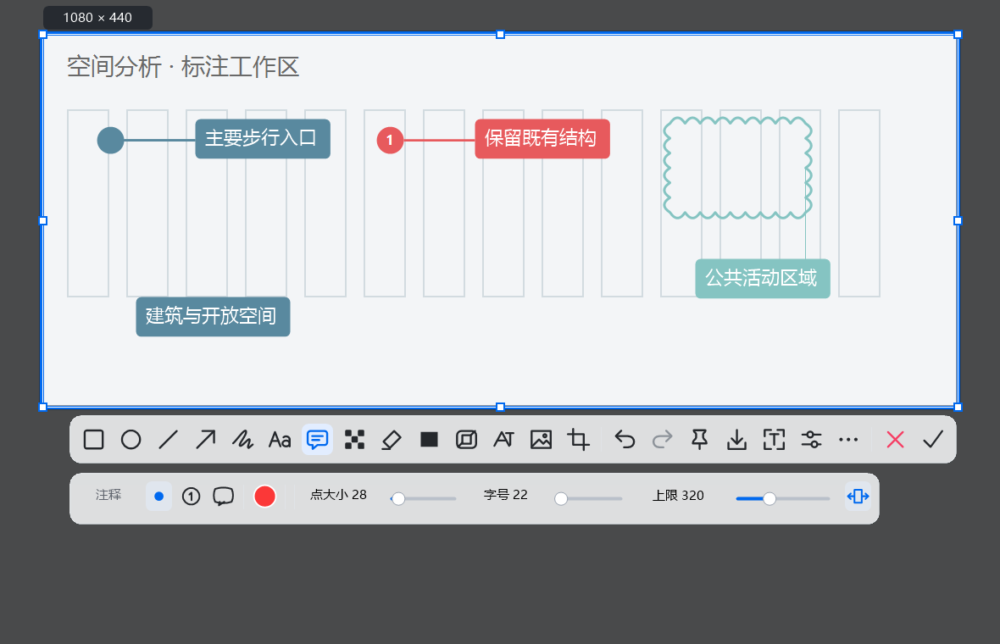

# ScreenCraft

一个 Windows 截图、标注和贴图工具。截图后可以直接添加箭头、文字和备注，也可以把图片钉在桌面上，方便对照资料。



## 主要功能

- **截图**：框选区域、截取窗口，自动吸附到窗口或控件边界。
- **标注**：箭头、画笔、文字、编号和云线，支持多选、调整大小、自由旋转和撤销；手绘线可自动闭合。
- **贴图**：多张图片独立置顶，可以缩放、旋转、翻转和调整透明度。
- **辅助工具**：本地文字识别（OCR）、取色、马赛克、水印和滚动长截图。
- **保存**：导出 PNG，或保存为可继续编辑的工程；自动保存默认使用系统桌面。

## 使用

支持 Windows 10 / 11（64 位），需要 .NET Framework 4.8。当前源码为 [0.10.2 开发预览版](docs/RELEASE_0.10.2.md)，截图与标注内核已经重写。

启动后程序会留在系统托盘：

- `Ctrl + Alt + A`：开始截图。
- 截图后直接标注，按 `Enter` 复制，按 `P` 钉到桌面。
- `Esc`：取消当前操作。
- 选中标注后，拖动选框上方圆点旋转；按住 `Shift` 按 15° 吸附。
- `Ctrl + ]` / `Ctrl + [`：前移 / 后移一层；加 `Shift` 置顶 / 置底。
- 画笔属性中的“自动闭合”可将手绘线首尾相连。
- 右键托盘图标可以打开设置、OCR、取色和其他工具。

更换版本前，请先退出旧版托盘。更多操作见 [使用说明](docs/USER_GUIDE.md)。

## 从源码运行

在 Windows PowerShell 中执行：

```powershell
git clone https://github.com/Louissagan/ScreenCraft.git
cd ScreenCraft
.\build.ps1
.\bin\Release\ScreenCraft.exe
```

构建使用系统自带的 .NET Framework 编译器。测试和打包命令见 [开发说明](docs/DEVELOPMENT.md)。

## 反馈

欢迎在 [Issues](https://github.com/Louissagan/ScreenCraft/issues) 中提交问题或建议。遇到截图、缩放或显示异常时，请附上复现步骤、Windows 版本和显示器缩放比例。

当前仍有一些功能限制，见 [已知问题](docs/KNOWN_LIMITATIONS.md)。

## 许可证

本项目采用 [MIT 许可证](LICENSE)。早期版本使用过 Stackshot 代码；0.10 已替换运行时内核，历史来源与版权声明继续保留。详情见 [重写记录](docs/CORE_REWRITE.md) 和 [第三方说明](THIRD_PARTY_NOTICES.md)。
