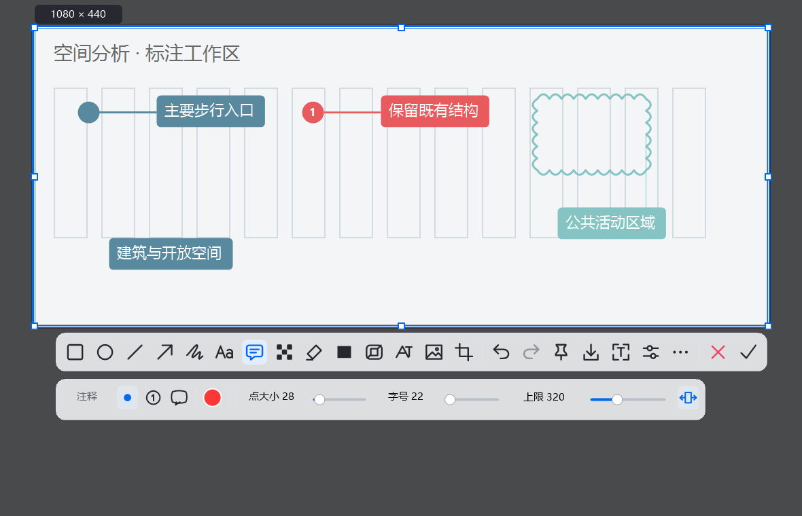

# ScreenCraft

一个 Windows 截图、标注和贴图工具。截图后可以直接添加箭头、文字和备注，也可以把图片钉在桌面上，方便对照资料。



## 主要功能

- **截图**：框选区域、截取窗口，自动吸附到窗口或控件边界。
- **标注**：线条、画笔、钢笔、文字、编号和云线，支持多选、自由旋转和撤销。钢笔可编辑锚点、曲线手柄和单段线宽，闭合区域可使用斜线、波点等图案填充。
- **贴图**：多张图片独立置顶，可以缩放、旋转、翻转和调整透明度。
- **辅助工具**：本地文字识别（OCR）、取色、马赛克、水印和滚动长截图。
- **保存**：导出 PNG，或保存为可继续编辑的工程；自动保存默认使用系统桌面。

## 使用

支持 Windows 10 / 11（64 位），需要 .NET Framework 4.8。当前源码版本为 0.10.8 开发预览版。

启动后程序会留在系统托盘：

- `Ctrl + Alt + A`：开始截图。
- 截图后直接标注，按 `Enter` 复制，按 `P` 钉到桌面。
- `Esc`：取消当前操作。
- 选中标注后，拖动选框上方圆点旋转；按住 `Shift` 按 15° 吸附。
- `Ctrl + ]` / `Ctrl + [`：前移 / 后移一层；加 `Shift` 置顶 / 置底。
- `B` 打开画笔，`G` 打开钢笔。钢笔单击添加角点、拖动添加平滑点，点击起点或按 `Enter` 闭合。
- 默认填充图案在「更多」中设置。选中某个图形后，在范围内右键可单独调整它的图案。
- 右键托盘图标可以打开设置、OCR、取色和其他工具。

更换版本前，请先退出旧版托盘。更多操作见 [使用说明](docs/USER_GUIDE.md)。

## 从源码运行

在 Windows PowerShell 中执行：

```powershell
git clone https://github.com/Louissagan/ScreenCraft.git
cd ScreenCraft
.\build.ps1
.\bin\Release\ScreenCraft.exe
```

构建使用系统自带的 .NET Framework 编译器。测试和打包命令见 [开发说明](docs/DEVELOPMENT.md)。

## 反馈

欢迎在 [Issues](https://github.com/Louissagan/ScreenCraft/issues) 中提交问题或建议。遇到截图、缩放或显示异常时，请附上复现步骤、Windows 版本和显示器缩放比例。

当前仍有一些功能限制，见 [已知问题](docs/KNOWN_LIMITATIONS.md)。

## 许可证

ScreenCraft 的应用代码采用 [MIT 许可证](LICENSE)。0.10 已替换早期使用的 Stackshot 运行时源码。MSI 安装模板仍含由 Stackshot 派生的结构，按其 MIT 许可保留版权声明。第三方材料与构建工具的许可见 [第三方声明](THIRD_PARTY_NOTICES.md)，内核变更见 [重写记录](docs/CORE_REWRITE.md)。
