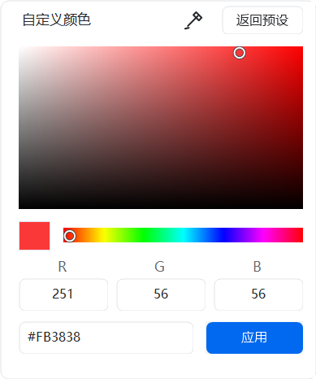

# ScreenCraft

Windows 原生截图、对象标注、多张独立置顶。仓库名为 Screenboard，应用名称为 ScreenCraft。

项目代码使用 [Apache License 2.0](LICENSE)；复用的 Stackshot 模块保留其 [MIT 许可证](src/Upstream/Stackshot/LICENSE) 和版权。详见 [第三方声明](THIRD_PARTY_NOTICES.md)。

**当前为 0.9.4 开发预览。237 项自动化回归通过。** 本版默认自动保存到系统桌面，支持中文及重定向路径；同时包含多选、八点缩放、统一注释与色板、工具栏设置、圆角导出、设置快捷键修复、OCR 语言选择及多层截图吸附。[本版测试说明](docs/RELEASE_0.9.4.md)

日常功能：

- 微信/QQ 式冻结框选与原位标注；显式当前屏全屏、当前窗口、重复区域入口，新增热键默认不占用任何组合键。
- 二级点/云线/序号模式，文字增长/换行/可调宽度、任意矩形圆角、独立说明、画笔平滑和白边箭头。
- 多张独立贴图；等比缩放、透明度、方向键、旋转/翻转、隐藏恢复、吸附、边框/阴影和滚轮偏好。
- 贴图工程保留原图对象与视图方向。Ctrl 拖动贴图准备 PNG 文件拖出；实际跨应用 OLE 尚未验收。
- 完成动作可选复制、复制并自动保存、仅保存；历史默认关闭，只清理自有副本。
- 独立多图画板，拖动/等比缩放/90° 旋转/层级/吸附/撤销，保存 scboard 工程及导出完整内容。
- 背景美化：纯色/12 种渐变、边距、圆角、采样边框、阴影及比例，保留源图与可撤销性。
- 本地 OCR、RGB/HEX/HSL 取色、垂直长截图、文字备忘、模糊/彩点遮盖、聚光灯和文字水印。

[用户手册](docs/USER_GUIDE.md) · [0.9 实现报告](docs/DAILY_WORKFLOW_0.9.0.md) · [安装教程](docs/INSTALLATION.md) · [更新日志核对](docs/1CAPTURE_CHANGELOG_AUDIT.md)

~~~powershell
.\build.ps1                      # 构建，不运行应用
.\build.ps1 -Test                # 合成/隐藏 HWND 回归
.\publish.ps1 -DistributionDirectory dist/0.9.4
.\tools\verify-package.ps1 -DistributionDirectory dist/0.9.4 -Rebuild
.\tools\test-installer.ps1       # 仅隔离测试包，静默安装到工作目录
~~~

构建应用使用系统 .NET Framework 4.8 编译器；MSI 首次构建下载并核验固定 SHA-256 的 WiX 3.14.1 工具 ZIP，不安装编译器。目标电脑不需要 SDK、WiX、Python 或联网下载依赖。

运行发布脚本后，交付生成在 `dist/0.9.4`：独立 EXE、Portable ZIP、每用户 MSI、Source ZIP 和 SHA256SUMS。请先退出旧版托盘再运行新版，单实例机制不会替换旧进程。MSI 默认不运行应用、不启用自启；安装后从开始菜单启动。

仍不是 1Capture 全功能一比一成品。QR、横向长图、图片水印、任意对象旋转、完整工作流/拖放架、AI 等仍有缺口；录屏/GIF 后置。真实跨应用粘贴、混合 DPI、标准账户登录/自启和安装向导均 NOT RUN。详情见 [已知限制](docs/KNOWN_LIMITATIONS.md) 与 [30 项验收报告](docs/ACCEPTANCE_REPORT.md)。

## 从源码开始

~~~powershell
git clone https://github.com/Louissagan/Screenboard.git
cd Screenboard
.\build.ps1
.\bin\Release\ScreenCraft.exe
~~~

需要 Windows 10/11 x64 与 .NET Framework 4.8。代码、测试与构建脚本均在仓库内；无需 NuGet 包。MSI 打包首次需要下载并校验 WiX 工具，详见构建命令与第三方声明。

本机配置、截图历史、编译产物和旧运行日志不入库。运行 `build.ps1 -Test` 可重新生成合成测试证据；历史报告中 `docs/evidence/` 链接指本地生成记录，不是随仓库发布的用户截图。当前公开副本已完成 237 项自动回归。

